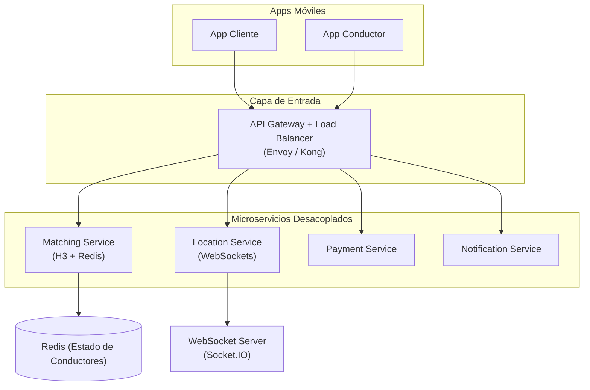

  <h1>🔔 PushApp — Análisis Técnico & Propuesta de Arquitectura</h1>
  
<em>Diagnóstico de cuellos de botella y propuesta de modernización para una plataforma de movilidad urbana en Venezuela</em>

  
  
  

---

## 🎯 El Contexto

**PushApp** (pushve.com) es una plataforma de transporte y servicios a domicilio activa en Venezuela, con más de 100,000 descargas en Play Store. A través de análisis de tráfico de red, permisos del APK y métricas públicas de usuario, se identificaron cuellos de botella de rendimiento críticos que afectan la experiencia tanto del pasajero como del conductor.

Este repositorio documenta el **diagnóstico técnico y la propuesta de arquitectura de referencia** presentada como parte de una evaluación técnica.

---

## 🚨 Diagnóstico: Problemas Identificados

| Problema | Impacto Medido |
|---|---|
| **Monolito rígido**: Backend unificado sin separación de servicios | Saturación en horas pico afecta TODOS los servicios simultáneamente |
| **HTTP Polling**: Actualización de ubicación cada 3-5 segundos | 2-3 segundos de delay en posición del conductor + alto consumo de batería |
| **Matching espacial ineficiente**: Consultas SQL crudas por lat/lon | 4-7 segundos para encontrar conductor disponible (tasa de abandono alta) |

---

## 🏗️ Arquitectura de Referencia Propuesta (Estándar Uber/Lyft)

---

## 🔑 Las 4 Mejoras Clave

### 1️⃣ Reemplazar HTTP Polling → WebSockets
Eliminar el polling de ubicación. Conexiones `full-duplex` persistentes vía Socket.IO reducen la latencia de actualización de posición de **2-3s a <100ms** y eliminan el consumo innecesario de batería.

### 2️⃣ Motor de Matching Espacial: H3 + Redis
En lugar de buscar conductores con cálculos trigonométricos en SQL, dividir la ciudad en **celdas hexagonales H3** (desarrollado por Uber) y guardar el estado de cada conductor en Redis. La búsqueda por "k-rings" reduce la complejidad de **O(N²) a O(1)**, logrando matching en < 500ms.

### 3️⃣ Patrón Strangler Fig para Migración
No reescribir el monolito completo (riesgo alto). Usar el **patrón Strangler Fig**: extraer progresivamente servicios críticos. Primer objetivo: aislar el Matching Service. El monolito sigue funcionando mientras el nuevo servicio es validado.

### 4️⃣ Observabilidad con OpenTelemetry + Grafana
Instrumentar el sistema para medir la reducción de latencia antes y después de cada despliegue. Dashboards que demuestren el ROI de cada mejora arquitectónica.

---

## 📅 Plan de Ejecución Propuesto (4 Semanas)

| Fase | Duración | Actividad |
|---|---|---|
| **PoC** | Semanas 1-2 | Desarrollar motor H3+Redis + servidor WebSockets independiente |
| **Canary Release** | Semana 3 | Desviar 20% del tráfico real al nuevo servicio de matching |
| **Migración Total** | Semana 4 | 100% del tráfico al nuevo servicio, desacoplar BD legacy |

---

> Análisis técnico y propuesta elaborada por **Gustavo Matheus** · *Systems Architecture & Backend Developer*
